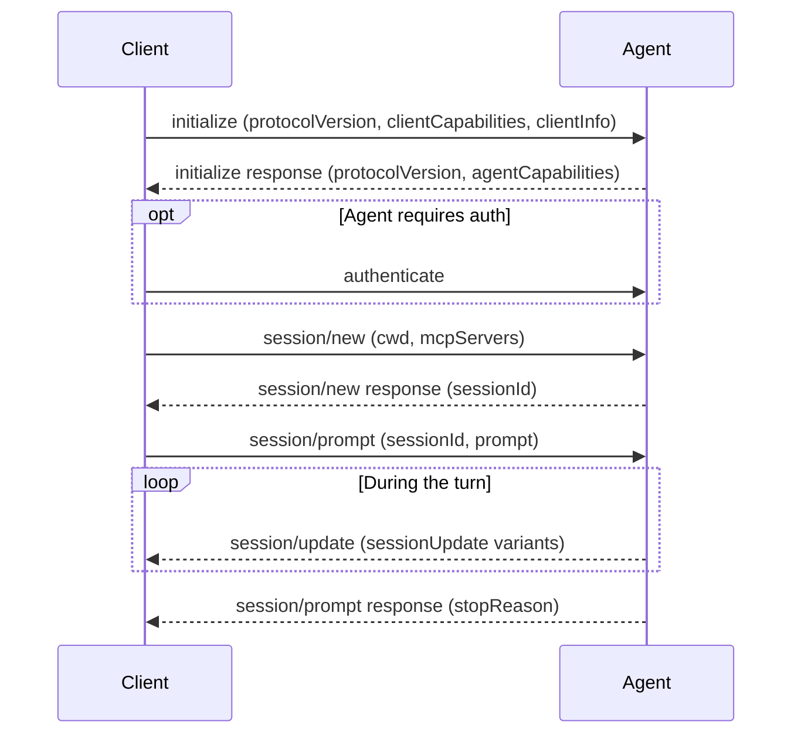

+++
title = "acp"
description = "Build, integrate, or debug Agent Client Protocol agents and clients with official SDKs. Use for ACP sessions, tool calls, schemas, transports, or protocol migrations."
sort_by = "title"
template = "skill.html"
[extra]
skill = true
category = "engineering"
mermaid = true
+++


# Agent Client Protocol (ACP)

The Agent Client Protocol (ACP) connects code editors and other clients to AI coding agents. It is built on JSON-RPC 2.0 and covers sessions, prompt turns, tool calls, permission requests, client file system and terminal access, and structured user input (elicitation).

The vendored docs in `resources/auto/` are the source of truth. Check them before writing method names, field names, or capability names from memory.

## Protocol overview

- Messages follow JSON-RPC 2.0 and must be UTF-8 encoded. There are two message kinds: methods (request-response pairs) and notifications (one-way, no response).
- Both sides call methods on each other. The client calls `session/prompt`; the agent calls `fs/read_text_file`, `terminal/create`, or `session/request_permission` on the client.
- Transport: stdio is the defined transport and should be supported whenever possible. The client launches the agent as a subprocess, messages are newline-delimited and must not contain embedded newlines, and the agent may log to stderr but must write only valid ACP messages to stdout. Streamable HTTP is still a draft proposal. Custom transports are allowed if they keep the JSON-RPC format and lifecycle.

## Connection lifecycle



### Initialization

`initialize` is the first request. The client sends the latest protocol version it supports plus its capabilities; the agent replies with the chosen version and its `agentCapabilities`.

```json
{
  "jsonrpc": "2.0",
  "id": 0,
  "method": "initialize",
  "params": {
    "protocolVersion": 1,
    "clientCapabilities": {
      "fs": {"readTextFile": true, "writeTextFile": true},
      "terminal": true
    },
    "clientInfo": {
      "name": "my-client",
      "title": "My Client",
      "version": "1.0.0"
    }
  }
}
```

### Session setup

`session/new` takes a `cwd` and an `mcpServers` list and returns a `sessionId`.

```json
{
  "jsonrpc": "2.0",
  "id": 1,
  "method": "session/new",
  "params": {"cwd": "/home/user/project", "mcpServers": []}
}
```

### Prompt turn

`session/prompt` sends the user message as a list of content blocks.

```json
{
  "jsonrpc": "2.0",
  "id": 2,
  "method": "session/prompt",
  "params": {
    "sessionId": "sess_abc123def456",
    "prompt": [{"type": "text", "text": "Fix the lint errors in src/main.ts"}]
  }
}
```

During the turn the agent streams `session/update` notifications. The variant is selected by `params.update.sessionUpdate`:

```json
{
  "jsonrpc": "2.0",
  "method": "session/update",
  "params": {
    "sessionId": "sess_abc123def456",
    "update": {
      "sessionUpdate": "agent_message_chunk",
      "content": {"type": "text", "text": "Checking files..."}
    }
  }
}
```

v1 `sessionUpdate` variants: `user_message_chunk`, `agent_message_chunk`, `agent_thought_chunk`, `tool_call`, `tool_call_update`, `plan`, `available_commands_update`, `current_mode_update`, `config_option_update`, `session_info_update`, `usage_update`, `notice`, `compaction_update`, `compaction_summary_chunk`. The last three require matching client capabilities. Message chunks may carry an opaque `messageId`; chunks with the same `messageId` belong to one message.

The turn ends when the agent responds to `session/prompt` with a `stopReason`:

| Stop reason         | Meaning                                                        |
| ------------------- | -------------------------------------------------------------- |
| `end_turn`          | The model finished without requesting more tools.              |
| `max_tokens`        | The token limit was reached.                                   |
| `max_turn_requests` | The maximum number of model requests in one turn was exceeded. |
| `refusal`           | The agent refuses to continue.                                 |
| `cancelled`         | The client cancelled the turn.                                 |

### Cancellation

The client cancels a turn with the `session/cancel` notification. It should mark unfinished tool calls as `cancelled` and must answer pending `session/request_permission` requests with the `cancelled` outcome. The agent stops model and tool work, flushes pending updates, and responds to `session/prompt` with `stopReason: "cancelled"`, not an error.

## Session methods

| Method                      | Direction       | Gate                           | Purpose                                                        |
| --------------------------- | --------------- | ------------------------------ | -------------------------------------------------------------- |
| `session/new`               | Client to agent | Baseline                       | Create a session.                                              |
| `session/load`              | Client to agent | `loadSession` agent capability | Load a session; the agent replays history as `session/update`. |
| `session/resume`            | Client to agent | `sessionCapabilities.resume`   | Reconnect to a session without replaying history.              |
| `session/list`              | Client to agent | `sessionCapabilities.list`     | List sessions known to the agent.                              |
| `session/close`             | Client to agent | `sessionCapabilities.close`    | Cancel ongoing work and free a session's resources.            |
| `session/delete`            | Client to agent | `sessionCapabilities.delete`   | Remove a session from `session/list` results.                  |
| `session/set_config_option` | Client to agent | Agent returns config options   | Change a session config option value.                          |
| `session/set_mode`          | Client to agent | Agent returns modes            | Switch session mode (superseded by config options).            |
| `session/cancel`            | Client to agent | Notification                   | Cancel the current prompt turn.                                |

Other v1 methods: `authenticate`, `logout` (gated by `agentCapabilities.auth.logout`), `session/request_permission`, `fs/read_text_file`, `fs/write_text_file`, `terminal/create`, `terminal/output`, `terminal/wait_for_exit`, `terminal/kill`, `terminal/release`, and `elicitation/create` with the optional `elicitation/complete` notification.

## Feature notes

- Tool calls: the agent reports a `tool_call` update (with `toolCallId`, `title`, `kind`, `status`) and later `tool_call_update` updates. Before running a sensitive tool it may call `session/request_permission` with options such as `allow_once` or `reject_once`. See `protocol-v1-tool-calls.md`.
- Agent plan: plans are a `session/update` with `sessionUpdate: "plan"` and an `entries` list; each entry has `content`, `priority`, and `status`. Each plan update replaces the whole plan. See `protocol-v1-agent-plan.md`.
- Session config options: the agent advertises `select` or `boolean` options, optionally tagged with a `category` such as `mode` or `model`. The client changes values with `session/set_config_option`, and the agent can push changes via `config_option_update`. See `protocol-v1-session-config-options.md`.
- Elicitation: the agent asks for structured, non-sensitive input with `elicitation/create` in form mode, or sends the user to an out-of-band URL in URL mode. Clients advertise supported modes under `clientCapabilities.elicitation`. See `protocol-v1-elicitation.md`.
- File system and terminals: only call `fs/*` or `terminal/*` methods when the client advertised the matching `clientCapabilities`. See `protocol-v1-file-system.md` and `protocol-v1-terminals.md`.

## v1 and v2 (draft)

ACP v2 is published as a draft. Implementations should keep v1 working, negotiate the version per connection via `protocolVersion` in `initialize`, and gate v2 behind feature flags. Key v2 changes from `protocol-v2-migration.md`:

- The `session/prompt` response only acknowledges acceptance. Progress, completion, and the stop reason arrive in `state_update` notifications.
- Updates are upserts patched by ID: omitted fields are unchanged, `null` clears, values replace, chunks append.
- The client file system, terminal, and session modes APIs are removed. `session/load` is replaced by `session/resume` with `replayFrom`, and `session/set_mode` by `session/set_config_option`.
- `authenticate` and `logout` become `auth/login` and `auth/logout`. `session/list`, `session/resume`, and `session/close` become required.
- Capabilities are reorganized into one `capabilities` object plus a required `info` field on each side.

## SDKs and tooling

| Language   | Package                                            | Source                    |
| ---------- | -------------------------------------------------- | ------------------------- |
| TypeScript | `@agentclientprotocol/sdk` (npm)                   | `libraries-typescript.md` |
| Rust       | `agent-client-protocol` (crates.io)                | `libraries-rust.md`       |
| Python     | `agent-client-protocol` (PyPI)                     | `libraries-python.md`     |
| Kotlin     | `com.agentclientprotocol:acp` (Maven Central, JVM) | `libraries-kotlin.md`     |
| Java       | `agentclientprotocol/java-sdk` repository          | `libraries-java.md`       |

The Rust and TypeScript SDKs reached 1.0.0 (`announcements-sdk-1-0-releases.md`). Community libraries are listed in `libraries-community.md`. The `agentclientprotocol/acp-tck` Test Compatibility Kit drives an agent over stdio and reports which spec requirements pass (`libraries-testing.md`). The ACP Registry distributes ACP agents to clients (`get-started-registry.md`).

## Lookup protocol

Search `resources/auto/` before answering a protocol question:

- Message shapes and lifecycle: `protocol-v1-overview.md`, `protocol-v1-initialization.md`, `protocol-v1-session-setup.md`, `protocol-v1-prompt-turn.md`, `protocol-v1-cancellation.md`, `protocol-v1-transports.md`.
- Field-level types and every `SessionUpdate` variant: `protocol-v1-schema.md`.
- Optional features: `protocol-v1-tool-calls.md`, `protocol-v1-agent-plan.md`, `protocol-v1-session-config-options.md`, `protocol-v1-elicitation.md`, `protocol-v1-file-system.md`, `protocol-v1-terminals.md`, `protocol-v1-authentication.md`, `protocol-v1-session-list.md`, `protocol-v1-session-delete.md`.
- v2 draft: `protocol-v2-migration.md` and the other `protocol-v2-*.md` files.
- Feature status: `announcements-*.md` for stabilized features, `rfds-*.md` for proposals that may not be stable yet.
- SDKs: `libraries-*.md`.
- Full index: `llms.txt`.

## Completion criteria

- Verify all JSON-RPC method names, field names, `sessionUpdate` variants, and capability flags against `resources/auto/protocol-v1-schema.md` (or `resources/auto/protocol-v2-*.md` for v2 draft work).
- For stdio transports, confirm `stdout` emits only newline-delimited JSON-RPC messages (no embedded newlines or diagnostic output) and all logging goes to `stderr`.
- Run the project's SDK test suite or `acp-tck` when applicable to confirm handshake, session lifecycle, and cancellation behavior.

