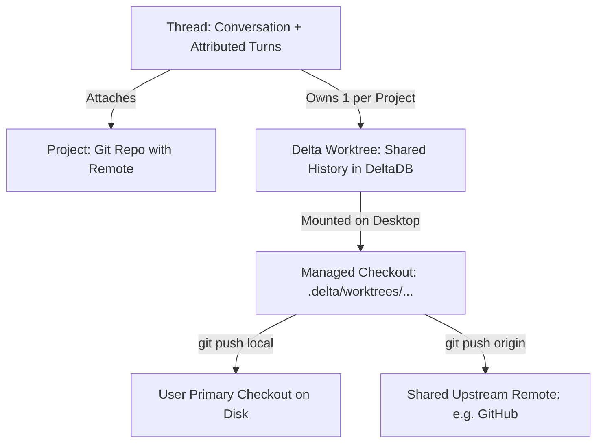

+++
title = "delta"
description = "Operate and configure Delta and DeltaDB, the multiplayer agent coding environment and CRDT version control system from Zed Industries. Use when working in or configuring Delta threads, subthreads, subagents, Delta worktrees, managed checkouts, the delta CLI, .agents/prepare, .agents/linked, .delta/ overrides, Land skills, or understanding DeltaDB CRDT deltas, fragment indexes, and Git remote synchronization. Do not use for Zed editor settings or git-delta diff pagers."
sort_by = "title"
template = "skill.html"
[extra]
skill = true
category = "tooling"
mermaid = true
+++


<!-- cspell:ignore deltadb subthread subthreads subagent subagents worktree worktrees Jujutsu colocated colocate linearithmic projectless xattr -->

# Delta and DeltaDB

Delta is a multiplayer environment for coding with AI agents built by Zed Industries. Underneath Delta sits **DeltaDB**, a distributed CRDT version control and synchronization layer that records thread conversations, inline comments, and file edits continuously as fine-grained deltas rather than waiting for manual Git commits.

## Progressive disclosure and reference resources

Use the vendored documentation in `resources/auto/` as the source of truth for release-specific behavior, UI paths, and edge cases:

- **Product reference (Delta 101):** See [resources/auto/docs-delta-101.md](@/skills/tooling/delta/resources/auto/docs-delta-101.md) for the release-scoped specification of all desktop and browser behaviors.
- **Core concepts:** See [resources/auto/docs-concepts-core-concepts.md](@/skills/tooling/delta/resources/auto/docs-concepts-core-concepts.md) for how threads, projects, Delta worktrees, and checkouts fit together.
- **DeltaDB and Git integration:** See [resources/auto/docs-concepts-delta-and-git.md](@/skills/tooling/delta/resources/auto/docs-concepts-delta-and-git.md) and [resources/auto/blog-future-of-version-control.md](@/skills/tooling/delta/resources/auto/blog-future-of-version-control.md) for CRDT internals, fragment indexes, Jujutsu support, and dual Git remotes.
- **Delta worktrees and checkouts:** See [resources/auto/docs-concepts-worktrees.md](@/skills/tooling/delta/resources/auto/docs-concepts-worktrees.md) and [resources/auto/blog-escaping-the-tyranny-of-worktrees.md](@/skills/tooling/delta/resources/auto/blog-escaping-the-tyranny-of-worktrees.md) for checkout lifecycle and branch isolation.
- **Project setup (`.agents/` and `.delta/`):** See [resources/auto/docs-configuration-project-setup.md](@/skills/tooling/delta/resources/auto/docs-configuration-project-setup.md) for `.agents/prepare`, `.agents/linked`, and `.delta/` overrides.
- **Reviewing and landing changes:** See [resources/auto/docs-agents-review-and-sync.md](@/skills/tooling/delta/resources/auto/docs-agents-review-and-sync.md) for diff comparisons, review subthreads, Land skills, and pushing to `local` or `origin`.
- **Skills, subagents, and MCP:** See [resources/auto/docs-agents-skills.md](@/skills/tooling/delta/resources/auto/docs-agents-skills.md), [resources/auto/docs-agents-subagents.md](@/skills/tooling/delta/resources/auto/docs-agents-subagents.md), and [resources/auto/docs-agents-mcp.md](@/skills/tooling/delta/resources/auto/docs-agents-mcp.md).
- **Settings, keybindings, and troubleshooting:** See [resources/auto/docs-configuration-settings.md](@/skills/tooling/delta/resources/auto/docs-configuration-settings.md), [resources/auto/docs-configuration-keybindings.md](@/skills/tooling/delta/resources/auto/docs-configuration-keybindings.md), and [resources/auto/docs-troubleshooting.md](@/skills/tooling/delta/resources/auto/docs-troubleshooting.md).
- **Data storage and privacy:** See [resources/auto/docs-privacy-and-security-data-storage.md](@/skills/tooling/delta/resources/auto/docs-privacy-and-security-data-storage.md) for Cloudflare storage topology, redaction, and retention rules.

---

## 1. Core architecture: threads, Delta worktrees, and DeltaDB

Delta separates durable conversation and edit history from temporary on-disk directories:



### Domain model

- **Thread**: The unit of work combining an agent conversation, participant comments, and one Delta worktree per attached project. Reverting a conversation to an earlier message (`Edit > Revert Conversation to Cursor`) rewinds both the transcript and the attached Delta worktrees together.
- **Project**: The top-level folder of a Git repository opened in Delta. Every attached project **must** have a configured Git remote (used by DeltaDB to identify the repository). If multiple remotes exist, one must be named `origin`.
- **Delta worktree**: The replicated file representation and continuous edit history for a project within a single thread, stored inside DeltaDB. Unlike a Git worktree, multiple Delta worktrees can work on the same branch name concurrently without colliding.
- **Checkout**: The physical directory on a desktop machine where Delta materializes a Delta worktree for terminal commands, builds, and editors. Managed checkouts live under `.delta/worktrees/` inside the connected local clone (or in Delta's app storage when joining a shared thread without a local clone) and are deleted automatically when the thread is archived.

### How DeltaDB CRDTs work

Where Git captures discrete commit snapshots, DeltaDB records a continuous causal stream of fine-grained deltas (file edits, file tree mutations, messages, and comments):

```rust
struct EditDelta {
    insert: String,
    at: Range<usize>,
    based_on: Version,
}

enum Version {
    Git(Sha1),
    Delta(Vec<DeltaId>),
}
```

1. **Causal graph anchoring**: Each delta identifies its parent version explicitly - either a base Git object (`Version::Git(Sha1)`) or one or more prior deltas (`Version::Delta(Vec<DeltaId>)`) when concurrent edits merge. No distributed wall-clock is required.
2. **Fragment index (B-tree)**: Each document stores its text alongside a B-tree fragment index mapping character ranges to the `DeltaId` (or base Git blob) that created them. When an out-of-date concurrent delta arrives referencing position `X` in version `V`, DeltaDB queries the fragment index for version `V` and resolves concurrent insertions at the same offset deterministically via actor ID tiebreaking.
3. **Structural sharing**: Because fragment index trees are immutable, each new version allocates only the spine nodes from the root to the modified leaf and shares all unchanged subtrees with prior versions. Memory and index maintenance scale as `O(N log N)` with edit count rather than quadratically.
4. **Character-level provenance**: Because every fragment records the delta that produced it, comments and review anchors bind to stable change identities rather than brittle line numbers, surviving across subsequent edits and rebases onto new Git commits.
5. **Cloudflare storage topology**: DeltaDB stores file contents, Git commits, history packs, and checkpoints in Cloudflare R2; active thread and Delta worktree synchronization deltas and account settings in SQLite-backed Cloudflare Durable Objects; and thread/repository/collaborator metadata in Cloudflare KV and D1.

---

## 2. Git integration and bringing changes back

Delta imports all Git-tracked files (even if later matched by `.gitignore`), uncommitted modifications to tracked files, and untracked files not ignored by `.gitignore`. Untracked ignored files (such as `.env` or build outputs) stay machine-local and are never recorded in DeltaDB.

### Checkout modes

Before sending the first message in a thread, the status bar's **Project Settings** control (`Cmd+Option+O` on macOS, `Ctrl+Alt+O` on Linux/Windows) selects where the thread works:

1. **Isolated Delta Worktree (default)**: Creates a managed checkout under `.delta/worktrees/` starting from the remote's default branch (or the branch marked via **Make default branch for Delta worktrees**). Safe for parallel agents.
2. **Existing Local Checkout**: Adopts your primary repository folder in place. Gives up isolation - edits appear directly in your working tree, and `.agents/prepare` is skipped.
3. **Existing Git Worktree**: Uses a linked Git worktree already created via `git worktree`.

### The two remotes in a managed checkout

Commits made by an agent inside a managed checkout land in that checkout's isolated Git repository, **not** in your primary project folder. To move committed work out of a managed checkout, use one of its two configured remotes:

- **`local` remote**: Points directly to your primary repository folder on the same machine. Pushing a branch to `local` transfers commits immediately without a round trip through GitHub:

  ```bash
  git push local <branch-name>
  ```

  If `<branch-name>` is currently checked out in your primary repository and its working tree is clean, pushing to `local` updates the working tree in place. If the working tree has uncommitted edits to tracked files, Git rejects the push.

- **Source remote (`origin`)**: Points to your shared upstream host (such as GitHub). Additional remotes (such as `upstream` alongside a fork) are preserved automatically:

  ```bash
  git push -u origin <branch-name>
  ```

### Jujutsu (`jj`) repositories

When opening a colocated Jujutsu repository (both `.git` and `.jj` present at the root) with `jj` installed on the machine, Delta runs `jj git init --colocate` in each managed checkout, fetches bookmarks through `local`, preserves the Jujutsu operation log across archive/mount cycles, and copies identity, signing, and `trunk()` settings.

---

## 3. Preparing a repository for Delta (`.agents/` and `.delta/`)

Because managed checkouts are created on every new thread and removed on archive, repository setup must be automated and fast.

| Purpose                 | Shared Path (multi-tool)         | Delta-Specific Override             | Behavior                                                                             |
| :---------------------- | :------------------------------- | :---------------------------------- | :----------------------------------------------------------------------------------- |
| Checkout setup script   | `.agents/prepare`                | `.delta/prepare`                    | Executable script run from checkout root on mount before agent starts.               |
| Symlinked ignored files | `.agents/linked`                 | `.delta/linked`                     | Line-separated list of `.gitignore`d repo-relative paths symlinked across checkouts. |
| Cloud Runner setup      | `.agents/setup`                  | `.delta/setup`                      | Setup script for Cloud Runner environments (staff-gated in v0.20.1).                 |
| Project skills          | `.agents/skills/<name>/SKILL.md` | `.delta/skills/<name>/SKILL.md`     | Reusable agent workflows; `.delta/skills/` overrides matching frontmatter `name`.    |
| Custom thread emoji     | N/A                              | `.delta/emoji/<shortcode>.png\|svg` | Committed PNG/SVG files exposed as `:shortcode:` in messages and comments.           |

### Writing `.agents/prepare`

1. Create `.agents/prepare` (or `.delta/prepare` to override exclusively for Delta) at the repository root and mark it executable (`chmod +x .agents/prepare`).
2. Use POSIX shell syntax (`#!/bin/sh`), even on Windows where Delta executes it via Git Bash.
3. Keep execution fast, non-interactive, and idempotent. Configure shared build caches or install from a local package store rather than linking `node_modules` across branches:

   ```sh
   #!/bin/sh
   set -eu

   pnpm install --frozen-lockfile
   ```

4. Note override precedence: if `.delta/prepare` exists, Delta runs it and ignores `.agents/prepare` completely (files are never merged, and an empty or failing `.delta/prepare` does not fall back).

### Sharing local ignored files with `.agents/linked`

1. Ensure every path to be shared is listed in the repository's `.gitignore` (not merely global gitignore) and is **not** tracked by Git.
2. List one literal repository-relative path per line using `/` separators (globs like `*.env` are not expanded):

   ```text
   # .agents/linked
   .env
   config/local.json
   ```

3. Commit both `.gitignore` and `.agents/linked` so new isolated threads inherit the symlink manifest while keeping secret contents machine-local.
4. Design parallel dev servers and tests to use configurable ports, database names, and container volumes rather than hardcoded constants, as isolated checkouts share the host OS kernel and network stack.

---

## 4. Threads, subthreads, subagents, reviews, and Land skills

### Subthreads and worktree merging

- **Spawn a subthread**: Press `Cmd+Shift+Enter` (macOS) or `Ctrl+Shift+Enter` (Linux/Windows) in the composer or on a comment chain, or invoke `/subthread`.
- **Worktree isolation**: A subthread starts with an isolated fork of its parent's conversation and Delta worktrees. Edits in the child do **not** merge back into the parent automatically on completion.
- **Merging back**: Ask the parent agent explicitly to merge the child's worktree changes, or ask the agent to merge specific project worktrees from multiple related threads in the same thread family (parent, subthreads, or forks).

### Subagent profiles

Delta ships three built-in subagent profiles configured under **Settings > Subagents**:

| Profile      | Role                              | Default Worktree Mode                | File-Editing Tools    | Can Spawn Subthreads |
| :----------- | :-------------------------------- | :----------------------------------- | :-------------------- | :------------------- |
| **Worker**   | Implements code changes           | `isolated` (requires explicit merge) | Yes                   | Yes                  |
| **Scout**    | Investigates codebase or web      | `shared` (mutates parent live)       | No (has terminal/web) | No                   |
| **Reviewer** | Audits changes and reports issues | `isolated`                           | No (has terminal/web) | No                   |

- **Safety invariant**: Neither `Scout` nor `Reviewer` is sandboxed; terminal commands run by a `Scout` execute directly inside the parent's live checkout.
- **Custom profiles**: Stored in account settings. Use **Settings > Subagents > Custom Profiles > Configure with Delta** to have `@Delta` create or edit profiles (setting `description`, `worktree` as `shared` or `isolated`, `prompt` or `system_prompt`, `model`, `thinking`, and provider `overrides`).

### Review threads and Land skills

- **Review threads**: Start via `/review` or `Cmd+Shift+R` (`Ctrl+Shift+R`). The agent generates a structured **change guide** walkthrough in forked Delta worktrees. Submit a verdict with **Submit Review** (`/approve` or `/request-changes`). If the reviewer made edits in the review thread, click **Pull Changes** on the verdict card in the parent thread to apply that snapshot.
- **Land skills**: Clicking **Land Changes** (`Cmd+L` on macOS, `Alt+L` on Linux/Windows) opens a dedicated Land subthread and executes a project skill whose YAML frontmatter declares:

  ```yaml
  ---
  name: land
  description: Land this project's changes when explicitly requested.
  metadata:
    delta-action: land
  ---
  ```

  Only lowercase `delta-action: land` makes a skill eligible; naming a skill `land` without the metadata key is insufficient.

### Rules hierarchy and MCP servers

- **Standing rules precedence** (most specific wins):
  1. Direct user prompt in the thread.
  2. Folder rules (`AGENT.md` or `AGENTS.md` in subdirectories read inward as files are accessed).
  3. Project root rules (first non-empty of `AGENT.md`, `AGENTS.md`, `CLAUDE.md`, `GEMINI.md`, `.rules`, `.cursorrules`, `.windsurfrules`, `.clinerules`, `.github/copilot-instructions.md`).
  4. Personal rules (first non-empty of `AGENT.md` or `AGENTS.md` in `~/.config/delta/` on macOS/Linux or `%APPDATA%\delta\` on Windows; overridable via `DELTA_CONFIG_DIR`).
- **MCP servers**: Configured in **Settings > MCP** (desktop only). Delta connects exclusively to remote HTTPS MCP endpoints using either no auth, OAuth 2.1 with dynamic client registration, or pre-registered OAuth (Slack, GitHub, Figma). Local stdio MCP servers and static bearer-token headers are not supported.

---

## 5. `delta` CLI and daemon management

The `delta` command-line binary controls authentication, organizations, daemon lifecycle, and local thread cleanup:

```bash
# Launch or focus the Delta desktop window
delta
delta <PATH_OR_URL>
delta open

# Manage background windowless daemon
delta daemon status
delta daemon start
delta daemon stop

# Account authentication
delta auth status
delta auth login
delta auth logout

# Organization management
delta org list
delta org current
delta org switch <org>
delta org create "Organization Name"
delta org invite user@example.com --org <org>

# Delete or purge local thread data (requires Delta app to be closed)
delta cli thread delete <thread-id>
delta cli thread purge
delta cli thread purge --force
```

- **Daemon lifecycle rule**: Starting Delta via `delta daemon start` (or another headless CLI subcommand) runs it windowless so it stays alive after windows close until `delta daemon stop`. Starting Delta with a window (`delta` or `delta open`) quits when the last window closes on Linux and Windows.

---

## 6. Verification and completion criteria

When configuring a repository for Delta, operating inside a Delta checkout, or diagnosing a Delta/DeltaDB workflow issue, verify completion against these checks:

1. **Git remote invariant**: Run `git remote -v` and confirm the repository has a remote configured, and that one remote is named `origin` whenever multiple remotes exist.
2. **Checkout setup verification**: If `.agents/prepare` or `.delta/prepare` was added or modified, verify it is executable (`test -x .agents/prepare || test -x .delta/prepare`), uses `#!/bin/sh`, and exits `0` cleanly when run from the repository root.
3. **Linked file verification**: If `.agents/linked` or `.delta/linked` was added or modified, verify every listed path uses `/` separators, contains no glob characters (`*`, `?`), is matched by `.gitignore`, and is untracked in Git (`git ls-files --error-unmatch <path>` must fail).
4. **Change transfer verification**: When asked to deliver committed changes from an isolated Delta checkout back to the user's local checkout, run `git push local <branch-name>` (or `git push -u origin <branch-name>` for upstream PRs) rather than stopping at `git commit`.
5. **Documentation grounding**: Confirm any cited Delta setting names, keyboard shortcuts, or CLI subcommands against the vendored files in `resources/auto/`.

