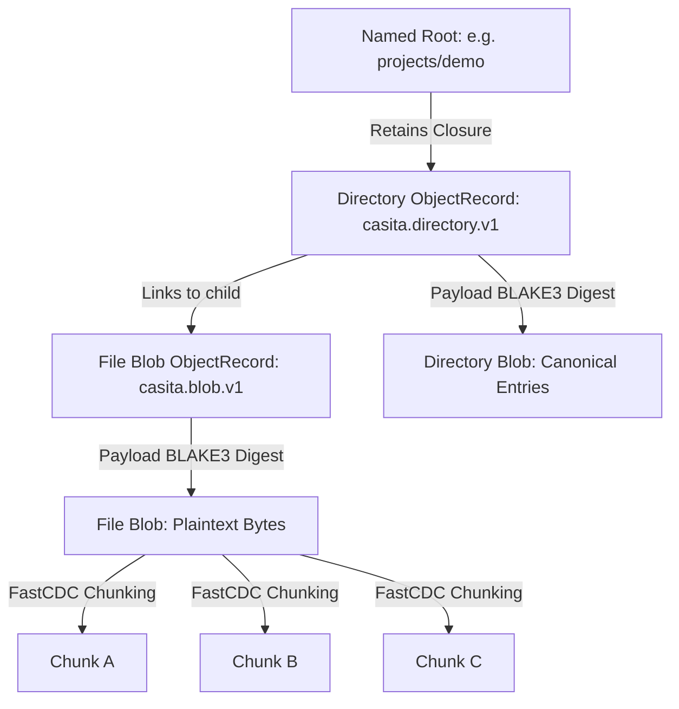

# Casita development and operations

Casita is a verified content-addressed repository engine for immutable object graphs, source code, and build artifacts. Written in Rust, it separates the storage layer of Nix into a standalone system: BLAKE3 payload hashing, FastCDC chunk deduplication, canonical directory graphs, verified repository synchronization, and reachability-based garbage collection.

Verify exact flags, method names, and signatures in the vendored docs before writing commands or code; the reference map is at the end of this skill.

---

## 1. Identity model

Casita separates byte storage from graph semantics through two distinct identity layers:



### Identity layers

- **`BlobId`**: The BLAKE3 digest of the complete plaintext bytes. Equal byte streams always share the exact same `BlobId`, regardless of which importer wrote them or how they are chunked or compressed.
- **`ObjectKey`**: A namespace-qualified string identifying a semantic object (e.g., `casita.directory.v1:<blake3>`, native Git commit SHA, or IPLD CID).
- **`ObjectRecord`**: Binds an `ObjectKey` to its physical `BlobId`, payload byte length, and an ordered list of forward retaining links to other objects.
- **`RootName`**: A validated hierarchical name (e.g., `projects/app/v1`, `releases/current`) pointing to one root `ObjectKey`. Roots retain their entire forward reachable closure.

---

## 2. CLI essentials

The `casita` CLI operates on a specified repository (`--repository <PATH>`) or on the default per-user workspace. Full syntax for every command is in `resources/auto/reference-cli-index.md`.

```bash
# Create ./cache/blobs (payloads) and ./cache/casita.sqlite (metadata)
casita --repository ./cache init

# Import a directory under a named root, then materialize it elsewhere
casita --repository ./cache import ./project --root projects/demo
casita --repository ./cache checkout casita.directory.v1:... ./restored --no-root

# Pin a rebuildable cache as evictable, and list roots with their retention
casita --repository ./cache root set cargo/cache casita.directory.v1:... --retention evictable
casita --repository ./cache root ls --long

# Copy a root to another repository, verified at the destination
casita sync --from ./cache --to ./mirror --root projects/demo

# Preview collection, then audit integrity
casita --repository ./cache gc --dry-run
casita --repository ./cache fsck --audit-only
```

- Directory import without `--root` assigns an automatic name under `auto/`. Repeat imports skip unchanged files by inode, size, and timestamps; `--filesystem-rehash` forces a full re-read.
- Manual `casita gc` and `vacuum` never delete named roots, including `evictable` ones. On local profiles, a mutation started above 80% disk usage triggers a nonblocking GC pass, and if usage stays at or above 75%, least-recently-used `evictable` roots are evicted until usage drops below 75%. Permanent roots are never evicted automatically.
- Casitar archives (`archive create`, `inspect`, `verify`, `import`) package a closure-verified graph for offline transport; see `resources/auto/guides-casitar-index.md`.
- Importers: filesystem, tar, Git, Casitar, and OCI; see `resources/auto/concepts-imports-index.md` and the per-importer `resources/auto/guides-*-index.md` files.

---

## 3. Rust API

Use the non-generic `casita::Repository` for standard applications (`resources/auto/reference-rust-api-index.md`):

```rust
use casita::import::BlobImport;
use casita::{ObjectKey, Repository, RootName};

#[tokio::main]
async fn main() -> Result<(), Box<dyn std::error::Error>> {
    // Persistent local repository; Repository::memory() gives an ephemeral one
    let repo = Repository::local("./cache").await?;

    let root = RootName::try_from("data/config")?;
    let payload = b"{\"environment\": \"production\"}\n";
    let key: ObjectKey = repo.import(BlobImport::new(payload.as_slice(), root)).await?;
    println!("Published object key: {key}");

    // Physical collection: unreachable records, then unreferenced blobs and chunks
    repo.collect().await?;

    // Finish payload writes and cleanup before runtime shutdown
    repo.flush().await?;
    Ok(())
}
```

For custom storage tiers, backends, or publication loops, enable the `experimental` Cargo feature and use `casita::experimental::Repository<PS, SS>` (`resources/auto/reference-experimental-rust-api-index.md`):

- Compose backends with `Repository::new(payloads, metadata)`; `CombinedBlobStore::new(near, far)` reads near first, falls back to far, and writes only to near.
- Acquire a `MutationSession` with `Repository::mutation_session().await`, stage payloads (`stage_blob`, `stage_object`, `stage_directory`), stage children before parents, then publish (`publish_unrooted`, `publish_rooted`, `publish_if_roots_match`).
- When several repositories share one payload store, use logical collection (`preview_logical_collection`, `collect_logical`). Its preview and outcome report record counts, not bytes reclaimed.

---

## 4. Pitfalls

- **Use evictable roots for rebuildable build caches**: Keep intermediate compilation caches (e.g. Cargo `target/`) under `--retention evictable` so disk-pressure GC can reclaim space automatically.
- **Use `--no-root` on temporary checkouts**: By default, `casita checkout` registers an `auto/checkout/...` root to prevent GC. Pass `--no-root` when checking out ephemeral build trees.
- **Use Bao verified reads when authentication is required upfront**: Standard sequential reads verify the complete BLAKE3 hash at EOF. If an operation seeks or aborts early, use `open_verified`.
- **Use `collect_logical()` (via the `experimental` feature) when sharing payload backends**: When several repositories share one blob store (e.g. multi-tenant S3), use logical collection so one repository does not delete blobs still needed by another.
- **Change repository state only through the `casita` CLI or Rust API**: `casita.sqlite` and its WAL files are owned by Casita's locks and revision checks.
- **Map destination roots explicitly in Casitar imports**: Casitar archives never guess destination root names, so pass `--casitar-root` or `--casitar-root-prefix`.

---

## 5. Reference map

Search `resources/auto/llms-full.txt` for the complete docs, or open the topic file:

- CLI: `resources/auto/reference-cli-index.md` and `resources/auto/getting-started-index.md`
- Rust APIs: `resources/auto/reference-rust-api-index.md`, `resources/auto/reference-experimental-rust-api-index.md`, and `resources/auto/reference-cargo-features-index.md`
- Concepts: `resources/auto/concepts-index.md`, `resources/auto/concepts-blob-storage-index.md`, and `resources/auto/concepts-directory-storage-index.md`
- Roots, retention, and collection: `resources/auto/concepts-roots-and-retention-index.md`, `resources/auto/concepts-garbage-collection-index.md`, and `resources/auto/concepts-shared-payload-services-index.md`
- Sync and archives: `resources/auto/guides-sync-index.md` and `resources/auto/guides-casitar-index.md`
- Operations and integrations: `resources/auto/guides-operations-index.md`, `resources/auto/integrations-cargo-index.md`, and `resources/auto/integrations-ipc-index.md`
- Error categories, retry guidance, and verification: `resources/auto/reference-errors-index.md`, `resources/auto/concepts-verification-index.md`, and `resources/auto/reference-object-formats-index.md`

---

## Completion criteria

- Verify exact CLI flags, object format namespaces, and Rust API signatures against the relevant `resources/auto/` reference pages before finalizing commands or code.
- In Rust code, confirm all open payload readers are dropped and `repo.flush().await?` is called before runtime shutdown.
- Run the applicable verification checks (`casita fsck`, `casita gc --dry-run`, or `cargo test`) and confirm clean results.
